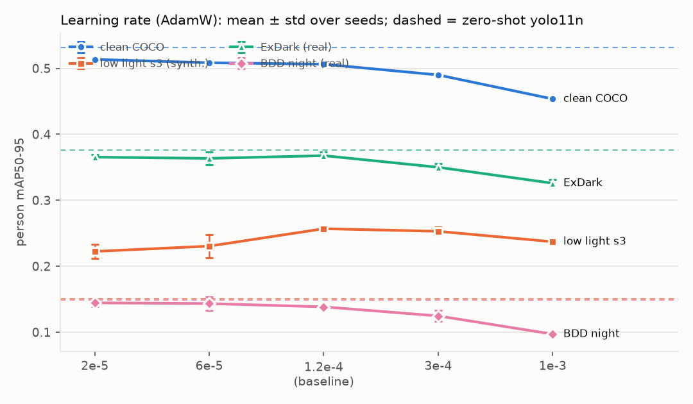
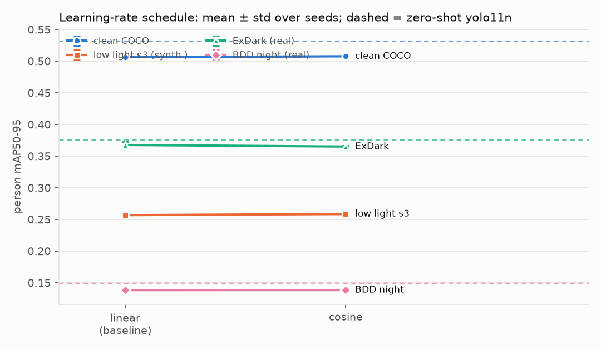
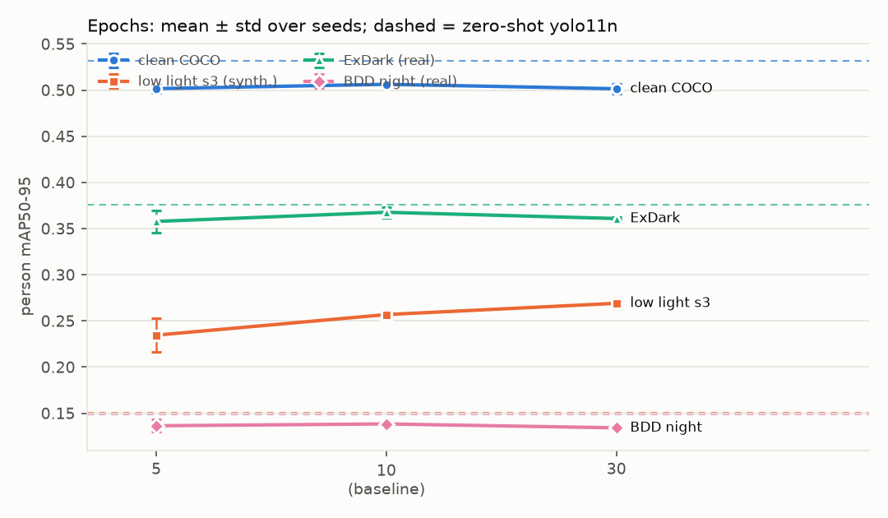
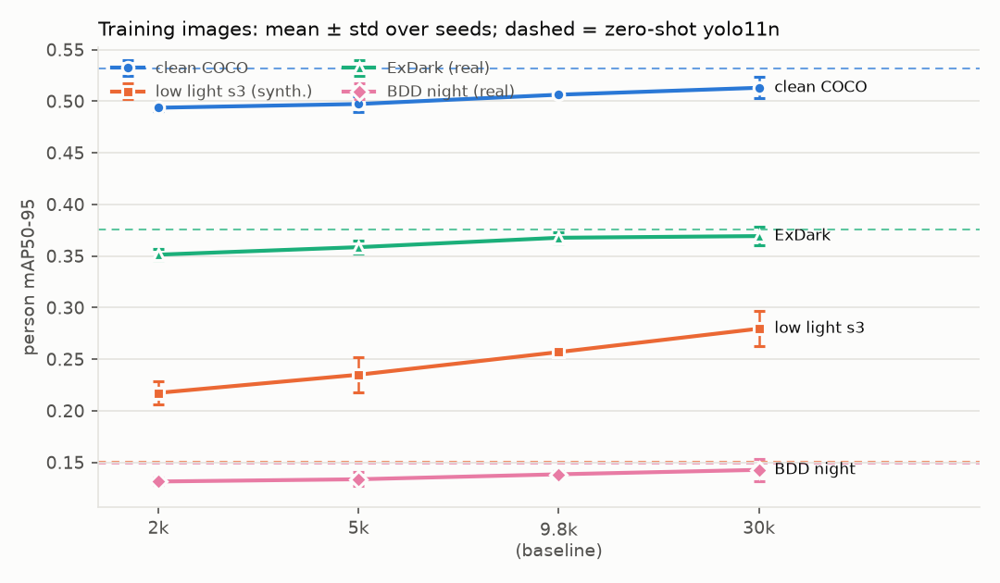
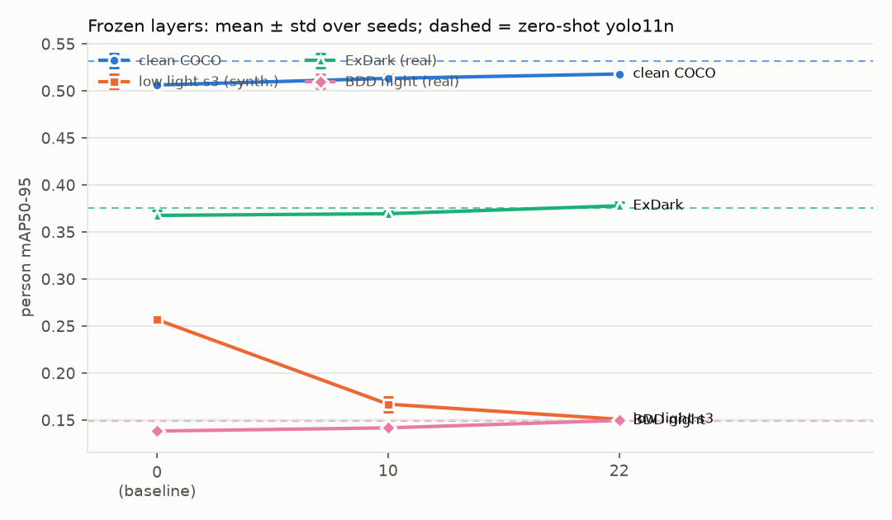
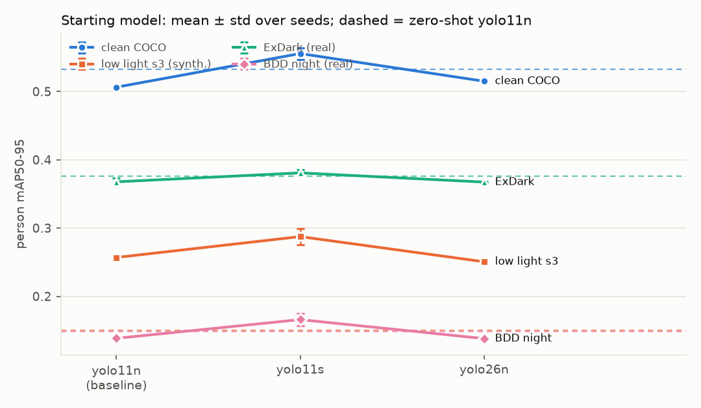

# Robust Computer Vision Under Difficult Conditions

**Status: Completed (2026-10-26).** Zero-shot baselines for three models, three fine-tuned variants (3 seeds), a diagnosis of the fine-tuning loss, a classical enhancement experiment and a 45-run fine-tuning sweep, all on synthetic and real test sets with confidence intervals. Full write-up: [docs/report.md](docs/report.md); two-page version: [docs/summary.md](docs/summary.md); model card: [models/README.md](models/README.md).

How much does a pretrained YOLO detector degrade on **people** (primary) and animals (secondary) in low light, fog, rain, snow, motion blur, noise and partial occlusion, and which cheap intervention (fine-tuning, condition-aware augmentation, enhancement preprocessing) recovers the most accuracy per millisecond of latency?

The motivation is disaster response: finding people in poor conditions. Part 1 of 3 in a connected portfolio: computer vision, then ROS 2 navigation ([ros2-slam-navigation](https://github.com/jayesh518/ros2-slam-navigation)), then a physical rover ([autonomous-rescue-rover](https://github.com/jayesh518/autonomous-rescue-rover)).

Project phases and status: [PHASES.md](PHASES.md).

## Key results
- **How much does the pretrained detector lose?** A lot under my synthetic stress (person mAP50-95 0.53 clean, 0.15 for strong low light or motion blur), but on **real** photographs only night shows a clear drop (BDD100K 0.198 by day, 0.149 at night).
- **Does fine-tuning recover it?** It learns the synthetic degradations (+0.07 to +0.17) but **not** real photographs: of 60 comparisons with the matching zero-shot model across a 45-run sweep, only 2 came out ahead. A negative result, reported as such.
- **What does preprocessing do?** Dark-channel dehazing helps on real fog (+0.039 [+0.007, +0.071], a thin set); low-light enhancement does not.
- **What is the best detector tested?** The pretrained yolo11s, with dehazing in front of it for fog. No fine-tuned weights are released because none is an improvement.
- **Not done, deliberately:** a failure gallery of images (no publishable photographs were available; dataset images are never published here), yolo26s, thermal sensing, any alive/dead claim. A live webcam demo is in `demo/`.

## Scope (staged on purpose)
**This project: single-camera RGB.** Thermal sensing, simulated thermal and any life-signs inference are later stages, not claims of this repository.

| Role | Classes (all COCO classes) | How reported |
|---|---|---|
| Primary | `person` | headline results, always first |
| Secondary | `cat, dog, horse, sheep, cow` | second table |
| Context | `car, bus, truck` | third table; lets an alert say "person partly hidden near a vehicle" |

- **Conditions:** low light, fog, rain, snow, motion blur, gaussian noise, and **partial occlusion** (a synthetic concrete-like slab hiding 25 / 50 / 75 % of a person's box).
- **Models:** `yolo11n` is the primary model (fits 4 GB for fine-tuning, fast enough for a small rover); `yolo11s` and `yolo26n` are evaluated zero-shot for comparison. 640 px, RTX 3050 Laptop GPU (4 GB).

## What this can and cannot say
- A 2D camera cannot distinguish "under" from "in front of" or "behind". The most this project can support is wording like *"person detected, partly hidden, overlapping a vehicle"*, always for a human to verify.
- The occlusion test is a **proxy** for debris: it hides a share of the **box**, not of the body, and a slab is not rubble.
- **No alive/dead or life-signs claim is made or planned.** A thermal camera reads surface heat only; it cannot see through concrete or rubble, and clothing, ambient temperature and the slow cooling of a body make temperature unreliable. A wrong "dead" label could cost a life. If thermal work is added later, the only output considered is "heat signature consistent with a person: present / absent / uncertain", as a hint for a human operator.

## What is real and what is synthetic
Every reported number is labelled accordingly.

| Evidence | Classes | Type |
|---|---|---|
| ExDark (low light) | person, cat, dog, car, bus | real photographs, **test-only** |
| DAWN (fog, rain, snow) | person, car, bus, truck | real photographs, **test-only** (very few person boxes) |
| BDD100K val (night, rain, snow; clear day as reference) | person (rider mapped to person), car, bus, truck | real photographs; only 13 foggy images |
| RTTS (haze) | - | **skipped**: no license stated by the authors |
| COCO val, degraded by `src/rcv/corrupt.py` / occluded by `src/rcv/occlude.py` | all 9 | **synthetic** (simplified models, not real weather or rubble) |

**Limitation:** no public dataset provides real fog/rain/snow images with animal boxes, so horse, cow and sheep (and cats and dogs outside low light) are evaluated under synthetic degradations only. Synthetic results are a controlled stress test, not a substitute for real conditions.

## Experiment variants
| ID | Description | Status |
|---|---|---|
| B0 | Pretrained, zero-shot (baseline), three models | **done** (see Results) |
| B1 | Fine-tuned on a clean COCO subset only: the control that separates "fine-tuning on this label set" from "learning robustness" | **done**, 3 seeds |
| A1 | B1 plus condition-aware augmentation (each image degraded with probability 0.5 by the same generator as the synthetic tests) | **done**, 3 seeds |
| A2 | A1 plus a BDD100K adverse-condition subset (fog, rain, snow, night; person and vehicles only, BDD has no animals). ExDark and DAWN stay test-only. | **done**, 3 seeds |
| E1 | Classical enhancement preprocessing (CLAHE, gamma, dark-channel dehazing, non-local-means) before B0, accuracy gain vs added latency | **done** (see Results) |

Training design: labels stay in the COCO-80 index space (the pretrained head is kept, so results compare directly with B0); a 9,831-image COCO train subset, a separate 500-image selection split (few animals in it, so a weak guide for animal classes), 3,130 BDD100K adverse images for A2; 3 seeds per variant.

Two caveats that accompany every A1/A2 result: (1) the training degradations and the **synthetic** test degradations come from the same generator, so gains on the synthetic sets are in-distribution and optimistic; only the **real** sets show whether they transfer; (2) A2 also has more and different data than A1, not only adverse conditions.

Metrics: mAP50-95, mAP50, precision, recall (per class, per condition, per severity, per occlusion level), person found-rate, batch-1 latency, model size, 95 % bootstrap intervals. Negative results are reported.

## Later stages (not part of this repository's claims yet)
1. Simulated thermal camera and humans in Gazebo (Project 2), as a controlled test.
2. RGB vs thermal vs fusion on real paired datasets (e.g. LLVIP, FLIR ADAS, HIT-UAV; licenses unverified).
3. Debris/slab detection needs its own dataset and labels; not in scope here.

## Setup
```
python -m venv .venv
.venv\Scripts\python -m pip install --index-url https://download.pytorch.org/whl/cu118 torch==2.7.1 torchvision==0.22.1
.venv\Scripts\python -m pip install -r requirements.txt
# requirements-lock.txt lists the exact versions that passed the tests (use it to reproduce an environment exactly)
.venv\Scripts\python -m pytest -q            # unit tests (CPU)
.venv\Scripts\python scripts\smoke_test.py   # GPU + pipeline check, writes results\smoke.json (not an accuracy result)
```

## Structure
```
configs/    classes.yaml (roles, label spaces), conditions.yaml (degradations, occlusion), datasets.yaml (sources, label maps)
src/rcv/    labels.py, data.py, corrupt.py, occlude.py, augment.py, enhance.py, stats.py, ci.py, eval.py
scripts/    download_data.py, prepare_coco.py, prepare_real_sets.py, prepare_bdd.py, make_synthetic.py,
            run_baseline.py, run_model_comparison.sh, crosscheck_coco_eval.py, measure_latency.py,
            make_results_tables.py, prepare_train_data.py, train.py, run_finetune_all.sh, make_finetune_tables.py,
            run_phase5.sh, run_phase5b.sh, run_phase5c.sh, make_phase5_table.py, run_lockbn_all.sh, make_phase5d_table.py,
            make_enhanced_sets.py, run_enhancement.py, make_e1_table.py, smoke_test.py
tests/      label mapping, parsers, degradation determinism/monotonicity, occlusion exactness, bootstrap CIs
            (AP reproduces pycocotools), augmentation serialisation, statistics
data/       not committed; see data/README.md for sources and licenses
models/     not committed; see models/README.md
results/    small, publishable summaries (JSON/CSV); smoke.json is an environment check only
docs/       report.md (written once results exist)
```

## Evaluation protocol, and how it was checked
All numbers come from Ultralytics `val` (confidence 0.001, NMS IoU 0.6, 640 px, multi-label NMS, no special handling of COCO "crowd" regions). `scripts/crosscheck_coco_eval.py` re-scores the same detections with the official `pycocotools` on the original COCO annotations. On the 1000-image sample the per-class AP50-95 agrees to within 0.024 (person 0.014, sheep 0.024, cow 0.020, all others 0.009 or less); the pycocotools value is higher for the crowd-heavy classes because it ignores detections that match crowd regions. See `results/crosscheck_coco.json`.

Two things to know when reading any number here:
- **NMS mode matters.** Scoring `predict` output (one class per box) instead of `val` output (multi-label) lowers AP for confusable classes by up to 0.07 (dog 0.703 -> 0.631; cat and truck about 0.03). The first run of the cross-check compared the wrong detections and failed because of this (`results/crosscheck_coco_attempt1_predict_reference.json` is kept as the record). All results here use the `val` protocol.
- **Small classes have wide uncertainty.** Cat, dog, horse, sheep and cow have few instances in the 1000-image sample, so their per-class AP is noisy. Bootstrap intervals will be reported with the results.

## Label spaces (a classic source of silent bugs)
Three numberings exist and are kept apart in `configs/classes.yaml`: the project id (0..8, used by fine-tuned models), the COCO 80-class index (what a COCO-pretrained model outputs) and the category id inside COCO's annotation JSON (person=1, car=3, cat=17, ...). `src/rcv/labels.py` converts between them and is unit-tested.

## Results
Zero-shot baseline (B0): COCO-pretrained detectors, no fine-tuning. Everything below is generated from `results/b0_<model>.json` by
`scripts/make_results_tables.py`; no number is copied by hand. Reproduce: `scripts/make_synthetic.py`, `scripts/prepare_real_sets.py`,
`scripts/prepare_bdd.py`, then `scripts/run_model_comparison.sh` and `scripts/make_results_tables.py --update-readme`.

<!-- RESULTS:START (generated by scripts/make_results_tables.py) -->
Models evaluated zero-shot: yolo11n, yolo11s, yolo26n. Intervals are 95 % bootstrap CIs (images resampled, 200 draws). Evidence labels: **synthetic** = degraded COCO val images; **real** = genuine photographs; **clean** = reference.

### Model comparison on clean images (COCO val, 1000-image sample; mAP50-95)

| Model | Person (primary) | Animals (secondary, macro) | Vehicles (context, macro) | Latency batch 1 |
|---|---|---|---|---|
| yolo11n | 0.532 [0.509, 0.551] | 0.612 [0.575, 0.660] | 0.408 [0.363, 0.475] | 16.1 ms median (2.6 M params) |
| yolo11s | 0.594 [0.573, 0.611] | 0.678 [0.645, 0.722] | 0.517 [0.465, 0.577] | 16.4 ms median (9.5 M params) |
| yolo26n | 0.528 [0.507, 0.547] | 0.637 [0.600, 0.682] | 0.440 [0.388, 0.496] | 22.0 ms median (2.6 M params) |

### Synthetic degradation, strongest severity (s3): person mAP50-95 and drop from clean

Severities are my own settings (`configs/conditions.yaml`): compare a condition with itself across models, not one condition against another.

| Condition (synthetic) | yolo11n: s3 (drop) | yolo11s: s3 (drop) | yolo26n: s3 (drop) |
|---|---|---|---|
| low light | 0.150 (-0.382) | 0.207 (-0.386) | 0.155 (-0.373) |
| fog | 0.393 (-0.139) | 0.496 (-0.098) | 0.411 (-0.116) |
| rain | 0.218 (-0.314) | 0.341 (-0.252) | 0.232 (-0.295) |
| snow | 0.408 (-0.124) | 0.498 (-0.096) | 0.414 (-0.113) |
| motion blur | 0.147 (-0.386) | 0.188 (-0.406) | 0.147 (-0.381) |
| gaussian noise | 0.335 (-0.197) | 0.422 (-0.172) | 0.357 (-0.171) |

### yolo11n: person mAP50-95 by condition and severity (synthetic), with CIs

| Condition | clean | s1 | s2 | s3 |
|---|---|---|---|---|
| low light | 0.532 [0.509, 0.551] | 0.475 [0.455, 0.494] | 0.379 [0.359, 0.398] | 0.150 [0.136, 0.166] |
| fog | 0.532 [0.509, 0.551] | 0.507 [0.485, 0.526] | 0.469 [0.448, 0.487] | 0.393 [0.375, 0.413] |
| rain | 0.532 [0.509, 0.551] | 0.504 [0.482, 0.523] | 0.460 [0.442, 0.479] | 0.218 [0.201, 0.234] |
| snow | 0.532 [0.509, 0.551] | 0.514 [0.493, 0.533] | 0.477 [0.457, 0.495] | 0.408 [0.389, 0.429] |
| motion blur | 0.532 [0.509, 0.551] | 0.434 [0.413, 0.454] | 0.276 [0.256, 0.294] | 0.147 [0.133, 0.162] |
| gaussian noise | 0.532 [0.509, 0.551] | 0.502 [0.480, 0.520] | 0.442 [0.423, 0.460] | 0.335 [0.315, 0.352] |

### Occlusion (synthetic slab hides part of each person's box; 500 images, all persons at least 40 px)

The strict score uses the person's FULL box as ground truth, but a detector boxes what it can SEE, so it falls even when the person is found. The **found rate** (a detection of a person at confidence 0.25 or more overlapping the full box with the stated IoU) is the lenient measure for "was a person detected there at all?".

| Model | Hidden | mAP50-95 | mAP50 | found IoU>=0.1 | found IoU>=0.3 | found IoU>=0.5 |
|---|---|---|---|---|---|---|
| yolo11n | 0 % | 0.721 [0.699, 0.747] | 0.924 | 0.950 [0.935, 0.965] | 0.913 [0.894, 0.933] | 0.885 [0.863, 0.909] |
| yolo11n | 25 % | 0.372 [0.353, 0.395] | 0.805 | 0.882 [0.860, 0.909] | 0.817 [0.788, 0.850] | 0.751 [0.718, 0.787] |
| yolo11n | 50 % | 0.064 [0.057, 0.073] | 0.286 | 0.761 [0.727, 0.796] | 0.642 [0.604, 0.688] | 0.345 [0.313, 0.382] |
| yolo11n | 75 % | 0.047 [0.042, 0.060] | 0.080 | 0.431 [0.393, 0.472] | 0.116 [0.092, 0.141] | 0.078 [0.059, 0.100] |
| yolo11s | 0 % | 0.772 [0.755, 0.794] | 0.950 | 0.960 [0.945, 0.973] | 0.943 [0.923, 0.960] | 0.919 [0.899, 0.940] |
| yolo11s | 25 % | 0.388 [0.370, 0.412] | 0.814 | 0.901 [0.879, 0.924] | 0.846 [0.818, 0.875] | 0.777 [0.745, 0.811] |
| yolo11s | 50 % | 0.060 [0.053, 0.070] | 0.304 | 0.809 [0.781, 0.837] | 0.687 [0.651, 0.725] | 0.382 [0.348, 0.417] |
| yolo11s | 75 % | 0.039 [0.033, 0.047] | 0.066 | 0.516 [0.478, 0.556] | 0.112 [0.092, 0.134] | 0.068 [0.052, 0.087] |
| yolo26n | 0 % | 0.729 [0.705, 0.754] | 0.927 | 0.951 [0.936, 0.967] | 0.914 [0.892, 0.935] | 0.885 [0.862, 0.911] |
| yolo26n | 25 % | 0.374 [0.358, 0.396] | 0.807 | 0.888 [0.865, 0.913] | 0.817 [0.784, 0.851] | 0.744 [0.711, 0.782] |
| yolo26n | 50 % | 0.079 [0.072, 0.089] | 0.313 | 0.759 [0.729, 0.793] | 0.647 [0.612, 0.690] | 0.362 [0.328, 0.398] |
| yolo26n | 75 % | 0.068 [0.055, 0.080] | 0.099 | 0.441 [0.401, 0.482] | 0.123 [0.102, 0.146] | 0.091 [0.072, 0.112] |

### REAL photographs (test-only): person mAP50-95, with person-box counts

BDD100K rows give the drop against the BDD **clear-daytime** reference (different images, so the interval comes from independent resampling). ExDark and DAWN have no clean reference, so no drop can be computed for them. Sets with few person boxes carry wide intervals: read the interval, not the point.

| Set (condition) | Person boxes | yolo11n | yolo11s | yolo26n | Drop vs reference (yolo11n) |
|---|---|---|---|---|---|
| ExDark (low light) | 7460 | 0.376 [0.366, 0.386] | 0.406 [0.397, 0.417] | 0.376 [0.366, 0.386] | - |
| DAWN fog | 117 | 0.399 [0.309, 0.492] | 0.486 [0.399, 0.563] | 0.388 [0.302, 0.481] | - |
| DAWN rain | 28 | 0.554 [0.426, 0.688] | 0.544 [0.409, 0.675] | 0.517 [0.373, 0.653] | - |
| DAWN snow | 158 | 0.453 [0.393, 0.528] | 0.515 [0.454, 0.588] | 0.468 [0.406, 0.545] | - |
| BDD clear day (reference) | 2624 | 0.198 [0.184, 0.213] | 0.263 [0.246, 0.278] | 0.198 [0.184, 0.215] | - |
| BDD clear night | 2328 | 0.149 [0.136, 0.164] | 0.191 [0.179, 0.206] | 0.142 [0.130, 0.156] | +0.049 [+0.031, +0.070] |
| BDD rainy day | 565 | 0.197 [0.173, 0.225] | 0.236 [0.213, 0.267] | 0.192 [0.167, 0.221] | +0.001 [-0.029, +0.029] |
| BDD snowy day | 708 | 0.223 [0.195, 0.254] | 0.296 [0.265, 0.330] | 0.220 [0.193, 0.251] | -0.026 [-0.056, +0.004] |
| BDD rainy night (vs clear night) | 235 | 0.109 [0.078, 0.154] | 0.127 [0.094, 0.173] | 0.107 [0.079, 0.152] | +0.040 [-0.014, +0.073] |
| BDD snowy night (vs clear night) | 288 | 0.157 [0.113, 0.208] | 0.206 [0.163, 0.258] | 0.160 [0.114, 0.213] | -0.009 [-0.063, +0.035] |
| BDD foggy (13 images) | 5 | 0.146 [0.006, 0.315] | 0.087 [0.035, 0.132] | 0.171 [0.045, 0.303] | - |

### REAL low light (ExDark): the other classes, macro mAP50-95 (cat and dog are the only real-photo animal evidence)

| Model | Animals: cat, dog | Vehicles: car, bus |
|---|---|---|
| yolo11n | 0.350 [0.334, 0.369] | 0.477 [0.464, 0.492] |
| yolo11s | 0.402 [0.387, 0.421] | 0.520 [0.506, 0.533] |
| yolo26n | 0.361 [0.347, 0.379] | 0.491 [0.478, 0.504] |

<!-- RESULTS:END -->

### Fine-tuning results (B1 / A1 / A2)
<!-- FINETUNE:START (generated by scripts/make_finetune_tables.py) -->
Model: `yolo11n`. Seeds evaluated so far: B1 3, A1 3, A2 3. 10 epochs, identical settings except as described. Each cell is person mAP50-95, mean ± sample std over seeds (n shown).

| Test set (evidence) | B0 zero-shot | B1 clean fine-tune | A1 + condition-aware aug. | A2 + BDD adverse data | A1 - B1 | A2 - A1 (confounded) |
|---|---|---|---|---|---|---|
| clean (COCO val sample) (clean) | 0.532 | 0.506 ± 0.006 (n=3) | 0.504 ± 0.003 (n=3) | 0.492 ± 0.008 (n=3) | -0.003 ± 0.007 (n=3) | -0.012 ± 0.011 (n=3) |
| low light s2 (synthetic) | 0.379 | 0.350 ± 0.010 (n=3) | 0.409 ± 0.004 (n=3) | 0.389 ± 0.027 (n=3) | +0.060 ± 0.006 (n=3) | -0.021 ± 0.028 (n=3) |
| low light s3 (synthetic) | 0.150 | 0.128 ± 0.003 (n=3) | 0.253 ± 0.006 (n=3) | 0.224 ± 0.039 (n=3) | +0.125 ± 0.004 (n=3) | -0.029 ± 0.042 (n=3) |
| fog s3 (synthetic) | 0.393 | 0.379 ± 0.024 (n=3) | 0.440 ± 0.007 (n=3) | 0.426 ± 0.025 (n=3) | +0.061 ± 0.017 (n=3) | -0.014 ± 0.026 (n=3) |
| rain s3 (synthetic) | 0.218 | 0.211 ± 0.002 (n=3) | 0.363 ± 0.008 (n=3) | 0.343 ± 0.035 (n=3) | +0.152 ± 0.006 (n=3) | -0.019 ± 0.035 (n=3) |
| snow s3 (synthetic) | 0.408 | 0.373 ± 0.012 (n=3) | 0.442 ± 0.004 (n=3) | 0.433 ± 0.016 (n=3) | +0.070 ± 0.010 (n=3) | -0.009 ± 0.019 (n=3) |
| motion blur s2 (synthetic) | 0.276 | 0.245 ± 0.006 (n=3) | 0.329 ± 0.007 (n=3) | 0.306 ± 0.023 (n=3) | +0.085 ± 0.005 (n=3) | -0.024 ± 0.025 (n=3) |
| motion blur s3 (synthetic) | 0.147 | 0.117 ± 0.006 (n=3) | 0.221 ± 0.011 (n=3) | 0.196 ± 0.029 (n=3) | +0.105 ± 0.007 (n=3) | -0.025 ± 0.031 (n=3) |
| noise s3 (synthetic) | 0.335 | 0.303 ± 0.005 (n=3) | 0.396 ± 0.003 (n=3) | 0.372 ± 0.037 (n=3) | +0.093 ± 0.005 (n=3) | -0.024 ± 0.038 (n=3) |
| ExDark low light (real) | 0.376 | 0.362 ± 0.007 (n=3) | 0.369 ± 0.008 (n=3) | 0.371 ± 0.004 (n=3) | +0.008 ± 0.005 (n=3) | +0.001 ± 0.010 (n=3) |
| DAWN fog (117 persons) (real) | 0.399 | 0.375 ± 0.003 (n=3) | 0.402 ± 0.005 (n=3) | 0.400 ± 0.033 (n=3) | +0.026 ± 0.007 (n=3) | -0.001 ± 0.038 (n=3) |
| DAWN rain (28 persons) (real) | 0.554 | 0.486 ± 0.017 (n=3) | 0.498 ± 0.012 (n=3) | 0.497 ± 0.031 (n=3) | +0.011 ± 0.021 (n=3) | -0.001 ± 0.021 (n=3) |
| DAWN snow (158 persons) (real) | 0.453 | 0.432 ± 0.014 (n=3) | 0.429 ± 0.004 (n=3) | 0.443 ± 0.019 (n=3) | -0.003 ± 0.016 (n=3) | +0.013 ± 0.015 (n=3) |
| BDD clear day (real) | 0.198 | 0.193 ± 0.003 (n=3) | 0.192 ± 0.007 (n=3) | 0.203 ± 0.005 (n=3) | -0.002 ± 0.004 (n=3) | +0.012 ± 0.011 (n=3) |
| BDD clear night (real) | 0.149 | 0.140 ± 0.003 (n=3) | 0.139 ± 0.004 (n=3) | 0.168 ± 0.008 (n=3) | -0.001 ± 0.002 (n=3) | +0.029 ± 0.012 (n=3) |
| BDD rainy day (real) | 0.197 | 0.189 ± 0.002 (n=3) | 0.191 ± 0.008 (n=3) | 0.212 ± 0.009 (n=3) | +0.003 ± 0.007 (n=3) | +0.020 ± 0.011 (n=3) |
| BDD snowy day (real) | 0.223 | 0.216 ± 0.007 (n=3) | 0.215 ± 0.010 (n=3) | 0.227 ± 0.017 (n=3) | -0.001 ± 0.003 (n=3) | +0.013 ± 0.022 (n=3) |

**Occlusion: person found rate (IoU >= 0.1, confidence >= 0.25)**

| Hidden | B0 | B1 | A1 | A2 |
|---|---|---|---|---|
| 0 % | 0.950 | 0.943 ± 0.009 (n=3) | 0.938 ± 0.003 (n=3) | 0.940 ± 0.017 (n=3) |
| 25 % | 0.882 | 0.880 ± 0.016 (n=3) | 0.879 ± 0.002 (n=3) | 0.888 ± 0.016 (n=3) |
| 50 % | 0.761 | 0.757 ± 0.014 (n=3) | 0.764 ± 0.009 (n=3) | 0.777 ± 0.031 (n=3) |
| 75 % | 0.431 | 0.450 ± 0.050 (n=3) | 0.456 ± 0.049 (n=3) | 0.511 ± 0.061 (n=3) |

<!-- FINETUNE:END -->

**What the fine-tuning shows** (yolo11n, 10 epochs, 3 seeds each; "±" is the sample standard deviation over 3 seeds, an indication of spread and not a significance test)

1. **Condition-aware augmentation (A1) helps a lot on the synthetic tests, as expected, and this is the optimistic number.** Against the clean control B1, A1 gains +0.125 ± 0.004 person mAP50-95 on strongest low light, +0.152 ± 0.006 on rain, +0.105 ± 0.007 on motion blur and +0.093 ± 0.005 on noise, with small spread. Training and test degradations come from the same generator, so this shows the model learned *my* degradations, not that it became robust to weather.
2. **On real photographs the gain is small or absent.** A1 minus B1: ExDark low light +0.008 ± 0.005, DAWN fog +0.026 ± 0.007, DAWN rain +0.011 ± 0.021, DAWN snow -0.003 ± 0.016, and BDD100K -0.002 to +0.003 (all within spread). Only DAWN fog and perhaps ExDark show a small positive shift. DAWN rain (28 persons) and snow are too thin to say more.
3. **Fine-tuning on this 9.8k-image COCO subset lowers accuracy compared with the zero-shot model** (the Phase 5 section below shows that about 0.01 of this is a batch-norm side effect of the training procedure, not of learning). B1 scores 0.506 on clean COCO against 0.532 zero-shot, and is below zero-shot on ExDark (0.362 vs 0.376), DAWN rain (0.486 vs 0.554) and BDD. Measured against **zero-shot B0**, A1 on real data roughly *recovers* that loss (ExDark 0.369 vs 0.376; DAWN fog 0.402 vs 0.399) and does not exceed it. This is the most important caveat: on real photographs none of A1 was shown to beat the pretrained model. Possible reasons, not tested: the small training subset, learning-rate and epoch choices, and a label space restricted to nine classes.
4. **Adding BDD100K adverse images (A2) helps on BDD100K and nowhere else measurable.** A2 minus A1: clear night +0.029 ± 0.012, rainy day +0.020 ± 0.011, clear day +0.012 ± 0.011. On ExDark and DAWN it is no different from A1 (+0.001 ± 0.010, -0.001 ± 0.038). A2 is **confounded** (it also has more and different data) and the BDD100K test images come from the same source as its training images, so the BDD gain is in-domain and does not demonstrate robustness to unseen conditions. A2 is slightly *worse* than A1 on the synthetic sets (-0.01 to -0.03, with a larger seed-to-seed spread of 0.02 to 0.04 for A2).
5. **A partly hidden person is not found more reliably after fine-tuning.** At 75 % hidden the found rate is 0.450 ± 0.050 (B1), 0.456 ± 0.049 (A1) and 0.511 ± 0.061 (A2), against 0.431 for zero-shot; the differences are within spread. Occlusion was never part of the training augmentation.

**What these fine-tuning results cannot say.** Only one model (yolo11n) and one training recipe were tried; hyperparameters were varied only in the phase 5 diagnosis (learning rate, frozen backbone, batch-norm lock) and none removed the loss from learning on the clean subset; three seeds give a rough spread, not a hypothesis test; the real-photo evidence for the weather conditions is thin (DAWN) or in-domain (BDD); and animals were not evaluated separately here. The honest summary: **learning my synthetic degradations is easy and large, but it did not transfer to real photographs (phase 5d: still below the zero-shot model with the batch-norm side effect removed), and training on BDD100K helped on BDD100K.** Whether better recipes or enhancement preprocessing (E1) do better is untested.

### Phase 5: why does the clean control score below zero-shot?
<!-- PHASE5:START (generated by scripts/make_phase5_table.py) -->
Person mAP50-95 with 95 % bootstrap intervals; every run is one seed (n=1), so differences below about 0.02 are within noise (seed-to-seed standard deviation in the 3-seed runs was 0.003 to 0.024 depending on the set).

| Run | What it is | clean COCO | low light s3 (synth.) | rain s3 (synth.) | ExDark (real) | DAWN fog (real) | BDD clear day (real) |
|---|---|---|---|---|---|---|---|
| B0 zero-shot | pretrained, nothing trained | 0.532 [0.509, 0.551] | 0.150 [0.136, 0.166] | 0.218 [0.201, 0.234] | 0.376 [0.366, 0.386] | 0.399 [0.309, 0.492] | 0.198 [0.184, 0.213] |
| D0 lr ~0, 3 epochs | training path with essentially no learning | 0.520 [0.500, 0.539] | 0.156 [0.142, 0.170] | 0.191 [0.176, 0.210] | 0.363 [0.353, 0.373] | 0.394 [0.309, 0.466] | 0.198 [0.185, 0.208] |
| D3 lr ~0, no augmentation | same, and no mosaic/colour/geometry augmentation | 0.522 [0.501, 0.540] | 0.171 [0.159, 0.187] | 0.203 [0.187, 0.221] | 0.363 [0.353, 0.373] | 0.394 [0.313, 0.472] | 0.196 [0.182, 0.206] |
| D5 lr ~0, batch-norm locked | same as D0 but every BatchNorm layer kept at the pretrained statistics | 0.529 [0.506, 0.547] | 0.147 [0.133, 0.163] | 0.234 [0.219, 0.253] | 0.381 [0.370, 0.391] | 0.395 [0.302, 0.470] | 0.201 [0.187, 0.212] |
| D1 lr 2e-5 | AdamW at 1/6 of the automatic rate | 0.516 [0.496, 0.536] | 0.129 [0.116, 0.146] | 0.236 [0.222, 0.253] | 0.376 [0.365, 0.386] | 0.374 [0.284, 0.459] | 0.196 [0.182, 0.207] |
| D2 frozen backbone | first 10 layers frozen | 0.516 [0.495, 0.536] | 0.130 [0.114, 0.144] | 0.219 [0.205, 0.235] | 0.369 [0.359, 0.379] | 0.387 [0.297, 0.464] | 0.196 [0.183, 0.209] |
| D4 original recipe, batch-norm locked | original clean-control recipe with every BatchNorm layer locked | 0.515 [0.493, 0.536] | 0.127 [0.115, 0.140] | 0.239 [0.224, 0.257] | 0.370 [0.361, 0.381] | 0.360 [0.272, 0.435] | 0.194 [0.180, 0.205] |
| B1 original (seed 0) | original clean-control recipe | 0.510 [0.491, 0.530] | 0.128 [0.113, 0.143] | 0.212 [0.198, 0.230] | 0.368 [0.358, 0.377] | 0.379 [0.295, 0.458] | 0.193 [0.180, 0.205] |
| A1 original (seed 0) | original recipe + condition-aware augmentation | 0.501 [0.481, 0.522] | 0.255 [0.239, 0.276] | 0.370 [0.351, 0.389] | 0.371 [0.362, 0.380] | 0.399 [0.306, 0.480] | 0.192 [0.178, 0.204] |
<!-- PHASE5:END -->

**What the diagnosis shows** (single seed each, so only differences clearly above about 0.02 are worth reading)

1. **Re-estimated batch-norm statistics explain the loss that appears without learning.** In training mode every BatchNorm layer re-estimates its running statistics on the small training batches (momentum 0.03), even when the learning rate is about zero. D0 (learning rate about zero) scores 0.520 on clean and 0.363 on ExDark, against 0.532 and 0.376 zero-shot. Removing augmentation (D3: 0.522 and 0.363) does not change this. Locking every BatchNorm layer (D5) restores the zero-shot scores: clean 0.529 (-0.003) and ExDark 0.381 (+0.005, only just inside the 0.005 tolerance set beforehand). So about 0.01 of the earlier "fine-tuning loss" was a side effect of the training procedure, not of learning.
2. **The rest of the loss comes from learning on the clean subset, and none of the recipes removed it.** With the batch-norm lock but the original recipe (D4) clean is 0.515 and ExDark 0.370, still below zero-shot; a lower learning rate (D1: 0.516 clean, ExDark 0.376) and a frozen backbone (D2: 0.516, 0.369) did no better than the original control (0.510, 0.368) beyond noise. Only D1 reaches zero-shot on ExDark, and neither it nor D4 reaches the clean target (within 0.01 of 0.532), so the pass rule written before the runs was not met by any recipe.
3. **Clean fine-tuning lowers low-light accuracy, and locking batch-norm does not prevent it.** Low light s3: D1 0.129, D2 0.130, B1 0.128 and D4 0.127, against 0.150 zero-shot and 0.147 for D5. Four recipes agree, so the loss of roughly 0.02 to 0.03 is not explained by drifting batch-norm statistics (an explanation I had expected to help). The condition-aware augmentation (A1: 0.255) more than makes up for it.
4. **Consequences for the earlier fine-tuning table.** The comparison between A1 and B1 (same training path) stays valid. All of B1, A1 and A2 carry the roughly 0.01 batch-norm side effect, which is about the same size as their gaps to zero-shot on real photographs (A1: ExDark 0.371 vs 0.376, DAWN fog 0.399 vs 0.399, BDD 0.192 vs 0.198). I therefore could not say whether A1 beats or merely matches the pretrained model on real photographs; phase 5d ran the batch-norm-locked A1 and answered it: it does not beat it.

**Phase 5 gate.** Met in part. The procedural loss is explained and removable (D5). The loss from learning on the clean subset is not: lowering the learning rate, freezing the backbone and locking batch-norm each left it in place. **Still untested:** whether more training data would remove it (the training subset is about 8 % of COCO train) and the effect of labelling only 9 of the 80 classes. The decision rule written beforehand said that when no recipe fixes the control, the three variants are not re-run, so they were not.

### Phase 5d: does condition-aware augmentation beat zero-shot on real photographs once batch-norm is locked?
<!-- PHASE5D:START (generated by scripts/make_phase5d_table.py) -->
Person mAP50-95, mean ± sample standard deviation over 3 seeds (yolo11n, 10 epochs). B1L and A1L are B1 and A1 with every BatchNorm layer locked.

| Run | clean COCO | low light s3 (synth.) | rain s3 (synth.) | motion blur s3 (synth.) | ExDark (real) | DAWN fog (real) | DAWN snow (real) | BDD clear day (real) | BDD clear night (real) |
|---|---|---|---|---|---|---|---|---|---|
| B0 zero-shot | 0.532 | 0.150 | 0.218 | 0.147 | 0.376 | 0.399 | 0.453 | 0.198 | 0.149 |
| B1 original | 0.506 ± 0.006 | 0.128 ± 0.003 | 0.211 ± 0.002 | 0.117 ± 0.006 | 0.362 ± 0.007 | 0.375 ± 0.003 | 0.432 ± 0.014 | 0.193 ± 0.003 | 0.140 ± 0.003 |
| A1 original | 0.504 ± 0.003 | 0.253 ± 0.006 | 0.363 ± 0.008 | 0.221 ± 0.011 | 0.369 ± 0.008 | 0.402 ± 0.005 | 0.429 ± 0.004 | 0.192 ± 0.007 | 0.139 ± 0.004 |
| B1L locked | 0.510 ± 0.009 | 0.121 ± 0.009 | 0.230 ± 0.012 | 0.113 ± 0.016 | 0.367 ± 0.003 | 0.370 ± 0.010 | 0.441 ± 0.003 | 0.196 ± 0.002 | 0.143 ± 0.002 |
| A1L locked | 0.498 ± 0.016 | 0.224 ± 0.041 | 0.337 ± 0.049 | 0.201 ± 0.040 | 0.362 ± 0.014 | 0.380 ± 0.020 | 0.429 ± 0.013 | 0.190 ± 0.009 | 0.139 ± 0.005 |

**Pre-registered rule, applied as written** (transfer supported if A1L minus zero-shot is at least +0.01 on all three of ExDark, DAWN fog and BDD clear night, and A1L beats B1L on ExDark in all 3 seeds):

| Set | A1L minus zero-shot, per seed | mean | needed |
|---|---|---|---|
| ExDark (real) | -0.029, -0.011, -0.002 | -0.014 | at least +0.010 |
| DAWN fog (real) | -0.041, -0.013, -0.002 | -0.019 | at least +0.010 |
| BDD clear night (real) | -0.016, -0.008, -0.006 | -0.010 | at least +0.010 |
| ExDark, A1L minus B1L | -0.023, +0.001, +0.007 | -0.005 | positive in all 3 seeds |

**Verdict: transfer NOT supported.**

<!-- PHASE5D:END -->

**What phase 5d shows** (3 seeds each; the decision rule was written before any of these runs)

1. **Against the zero-shot model, condition-aware augmentation did not help on real photographs, even with the batch-norm side effect removed.** A1L is below zero-shot on all three real sets the rule named: ExDark -0.014, DAWN fog -0.019 and BDD clear night -0.010 (means over 3 seeds; no seed reaches +0.01). It also does not reliably beat its own control on ExDark (A1L minus B1L: -0.023, +0.001, +0.007).
2. **Locking batch-norm did not make things better.** B1L is about the same as B1 (clean 0.510 vs 0.506, ExDark 0.367 vs 0.362). A1L is slightly *worse* than A1 on the synthetic sets and noticeably less stable across seeds (low light s3 0.224 ± 0.041 against 0.253 ± 0.006 unlocked; rain s3 0.337 ± 0.049 against 0.363 ± 0.008). A possible reason, **not tested**: with batch-norm unlocked, the statistics adapt to the degraded training images, which helps on the synthetic tests.
3. **What stands.** The augmentation clearly learns *my synthetic degradations* (low light s3: 0.224 to 0.253 against about 0.12 to 0.13 for the clean controls and 0.150 zero-shot; rain s3 about 0.34 to 0.36 against about 0.21 to 0.23). That gain is in-distribution. It did not carry over to real low-light, fog or night photographs in this setup.

**What this cannot say.** One model (yolo11n), one recipe (10 epochs, a 9.8k-image COCO subset, degradation probability 0.5), one set of synthetic degradations. A different degradation model, much more training data or a different training schedule might transfer; this study does not show that none can. The result is a negative one for this recipe, and it is reported as such.

### Phase 6 (E1): does classical enhancement before the unchanged model help?
<!-- E1:START (generated by scripts/make_e1_table.py) -->
Zero-shot yolo11n (unchanged) on original images and on the same images after classical enhancement. Gain = enhanced minus original person mAP50-95, paired on identical images, with a 95 % bootstrap interval.

| Source set | Method | Original | Enhanced | Gain vs original | Gain vs re-encode control | Enhancement time per image (median / p95) |
|---|---|---|---|---|---|---|
| clean COCO sample | CLAHE | 0.532 | 0.523 | -0.009 [-0.013, -0.006] | -0.005 [-0.009, -0.002] | 4 / 6 ms |
| clean COCO sample | adaptive gamma | 0.532 | 0.529 | -0.003 [-0.006, -0.001] | +0.000 [-0.002, +0.002] | 1 / 2 ms |
| clean COCO sample | dark-channel dehaze | 0.532 | 0.527 | -0.005 [-0.008, -0.002] | -0.001 [-0.003, +0.001] | 39 / 54 ms |
| clean COCO sample | non-local-means | 0.532 | 0.490 | -0.042 [-0.048, -0.036] | -0.039 [-0.045, -0.033] | 548 / 689 ms |
| low light s2 (synthetic) | CLAHE | 0.379 | 0.357 | -0.022 [-0.026, -0.017] | -0.021 [-0.025, -0.016] | 2 / 3 ms |
| low light s2 (synthetic) | adaptive gamma | 0.379 | 0.334 | -0.045 [-0.051, -0.037] | -0.044 [-0.051, -0.037] | 1 / 1 ms |
| low light s3 (synthetic) | CLAHE | 0.150 | 0.129 | -0.021 [-0.025, -0.016] | -0.026 [-0.030, -0.021] | 2 / 3 ms |
| low light s3 (synthetic) | adaptive gamma | 0.150 | 0.094 | -0.056 [-0.064, -0.049] | -0.061 [-0.069, -0.053] | 1 / 1 ms |
| ExDark (real) | CLAHE | 0.376 | 0.374 | -0.001 [-0.003, +0.002] | -0.001 [-0.003, +0.002] | 3 / 10 ms |
| ExDark (real) | adaptive gamma | 0.376 | 0.346 | -0.030 [-0.034, -0.026] | -0.030 [-0.034, -0.026] | 1 / 5 ms |
| BDD clear night (real) | CLAHE | 0.149 | 0.153 | +0.005 [+0.000, +0.008] | +0.005 [+0.002, +0.009] | 5 / 8 ms |
| BDD clear night (real) | adaptive gamma | 0.149 | 0.136 | -0.012 [-0.017, -0.008] | -0.012 [-0.016, -0.007] | 2 / 4 ms |
| fog s3 (synthetic) | dark-channel dehaze | 0.393 | 0.477 | +0.084 [+0.075, +0.091] | +0.084 [+0.075, +0.092] | 51 / 67 ms |
| DAWN fog (real, 117 persons) | dark-channel dehaze | 0.399 | 0.438 | +0.039 [+0.007, +0.071] | +0.037 [+0.007, +0.071] | 151 / 240 ms |
| noise s3 (synthetic) | non-local-means | 0.335 | 0.364 | +0.029 [+0.022, +0.037] | +0.021 [+0.015, +0.028] | 541 / 644 ms |

**Re-encode control** (the same images saved again without enhancement; should be near zero):

| Source set | control gain vs original |
|---|---|
| clean COCO sample | -0.004 [-0.006, -0.002] |
| low light s2 (synthetic) | -0.001 [-0.003, +0.001] |
| low light s3 (synthetic) | +0.005 [+0.003, +0.007] |
| ExDark (real) | +0.000 [-0.001, +0.001] |
| BDD clear night (real) | -0.001 [-0.002, +0.000] |
| fog s3 (synthetic) | -0.000 [-0.001, +0.001] |
| DAWN fog (real, 117 persons) | +0.002 [-0.004, +0.008] |
| noise s3 (synthetic) | +0.008 [+0.006, +0.010] |

Control check (all within 0.005 of zero): **not passed for every set; the gains vs the control column are the ones to read**.

**Pre-registered rule, applied as written** (a method helps on a condition if the paired gain is at least +0.01 with the interval's lower bound above 0, on the real set and on the synthetic set; harmful on clean images if the clean-sample gain is below -0.01 with the interval excluding 0):

| Condition | Method | Synthetic | Real | Clean-sample effect | Verdict |
|---|---|---|---|---|---|
| low light | CLAHE | -0.021 [-0.025, -0.016] | -0.001 [-0.003, +0.002] | -0.009 [-0.013, -0.006] | does not help |
| low light | adaptive gamma | -0.056 [-0.064, -0.049] | -0.030 [-0.034, -0.026] | -0.003 [-0.006, -0.001] | does not help |
| fog | dark-channel dehaze | +0.084 [+0.075, +0.091] | +0.039 [+0.007, +0.071] | -0.005 [-0.008, -0.002] | helps |
| noise | non-local-means | +0.029 [+0.022, +0.037] | no real set | -0.042 [-0.048, -0.036] (harmful) | synthetic-only possible |

Latency context: the detector forward pass is 16.1 ms (batch 1, GPU); the enhancement times above are CPU times at the stored image size and would add to it.

<!-- E1:END -->

**What the enhancement experiment shows** (zero-shot yolo11n, unchanged; classical methods only; rule fixed before the results)

1. **Dehazing helps on fog, in both synthetic and real data.** Dark-channel-prior dehazing raises person mAP50-95 on synthetic fog s3 by +0.084 [+0.075, +0.091] and on real DAWN fog by +0.039 [+0.007, +0.071]. This meets the pre-registered rule, with two cautions: DAWN fog has only 117 person boxes, so its interval is wide and its lower bound only just clears zero; and the method costs about 51 ms per image on the CPU for the synthetic images and about 151 ms for the larger DAWN photographs, three to nine times the detector's 16 ms forward pass (a GPU version was not tried). On clean images it costs a small -0.005.
2. **Low-light enhancement does not help.** CLAHE is neutral on real ExDark (-0.001 [-0.003, +0.002]) and slightly positive on real BDD night images (+0.005 [+0.000, +0.008], below the +0.01 bar); adaptive gamma hurts (-0.030 on ExDark, -0.012 on BDD night). On the synthetic low-light sets both hurt (-0.02 and -0.06). Looking at the images, the synthetic low light carries strong noise and brightening roughly doubles it (measured), which is the likely reason; this was observed, not isolated by a separate experiment.
3. **Non-local-means denoising helps on synthetic noise (+0.029 [+0.022, +0.037]) but is harmful on clean images (-0.042) and slow (about 0.55 s per image on the CPU).** There is no real noisy set, so it can be called synthetic-only at most.
4. **The extra JPEG save is a small confound.** The re-encode control moves some sets slightly (noise s3 +0.008, low light s3 +0.005, clean -0.004), so the table also gives gains against the control; the verdicts do not change.
5. **Compare with phase 5.** The training route (condition-aware augmentation) did not beat zero-shot on real photographs. For fog, a fixed classical preprocessing step does, on the one real fog set available. For low light, neither route helped in this study.

**What E1 cannot say.** Only classical methods were tried; learned enhancers (for example Zero-DCE or learned dehazing) were not, and may do better on low light. Rain, snow and motion blur were not tested. Real-photo evidence is one fog set of 117 persons, and ExDark and BDD night for low light. Enhancement was applied to every image; a gate that applies it only where needed was not studied, although the small clean-image cost of dehazing suggests it matters little for fog. Latency is CPU time for the enhancement alone and ignores image decoding.


### Phase 8: fine-tuning study (what each variable does)
<!-- SWEEP:START (generated by scripts/make_sweep_tables.py) -->
Baseline: A1 recipe on yolo11n (explicit AdamW lr 0.000119, momentum 0.9, 10 epochs, 9,831 images, nothing frozen). Seeds finished so far per setting: 3 to 3 of 3. Cells are person mAP50-95, mean ± sample std over the seeds present. **Effect** columns are the mean paired difference to the baseline: **REAL** = at least 0.01 in absolute value and the same sign in all 3 seeds; otherwise noise (or pending until 3 seeds exist). Zero-shot yolo11n for reference: clean COCO 0.532, low light s3 (synth.) 0.150, rain s3 (synth.) 0.218, 50 % hidden (synth.) 0.064, ExDark (real) 0.376, DAWN fog (real) 0.399, BDD day (real) 0.198, BDD night (real) 0.149.

#### Learning rate (AdamW)

| Level | clean COCO | low light s3 (synth.) | rain s3 (synth.) | 50 % hidden (synth.) | ExDark (real) | DAWN fog (real) | BDD day (real) | BDD night (real) | training time | train-val mAP50-95 (last epoch) |
|---|---|---|---|---|---|---|---|---|---|---|
| 2e-5 | 0.514 ± 0.001 (n=3) | 0.222 ± 0.011 (n=3) | 0.338 ± 0.012 (n=3) | 0.086 ± 0.012 (n=3) | 0.365 ± 0.004 (n=3) | 0.393 ± 0.002 (n=3) | 0.195 ± 0.004 (n=3) | 0.144 ± 0.005 (n=3) | 24 min | 0.479 |
| 6e-5 | 0.509 ± 0.004 (n=3) | 0.230 ± 0.018 (n=3) | 0.341 ± 0.019 (n=3) | 0.088 ± 0.009 (n=3) | 0.364 ± 0.010 (n=3) | 0.392 ± 0.005 (n=3) | 0.192 ± 0.006 (n=3) | 0.143 ± 0.010 (n=3) | 24 min | 0.476 |
| 1.2e-4 (baseline) | 0.506 ± 0.002 (n=3) | 0.257 ± 0.001 (n=3) | 0.370 ± 0.001 (n=3) | 0.099 ± 0.009 (n=3) | 0.368 ± 0.006 (n=3) | 0.399 ± 0.021 (n=3) | 0.192 ± 0.002 (n=3) | 0.138 ± 0.003 (n=3) | 24 min | 0.458 |
| 3e-4 | 0.490 ± 0.003 (n=3) | 0.253 ± 0.006 (n=3) | 0.366 ± 0.006 (n=3) | 0.110 ± 0.010 (n=3) | 0.350 ± 0.006 (n=3) | 0.386 ± 0.009 (n=3) | 0.182 ± 0.003 (n=3) | 0.125 ± 0.008 (n=3) | 24 min | 0.432 |
| 1e-3 | 0.454 ± 0.001 (n=3) | 0.237 ± 0.004 (n=3) | 0.346 ± 0.003 (n=3) | 0.070 ± 0.007 (n=3) | 0.326 ± 0.006 (n=3) | 0.345 ± 0.004 (n=3) | 0.164 ± 0.000 (n=3) | 0.097 ± 0.004 (n=3) | 24 min | 0.348 |

Effect against the baseline:

| Level | clean COCO | low light s3 (synth.) | rain s3 (synth.) | 50 % hidden (synth.) | ExDark (real) | DAWN fog (real) | BDD day (real) | BDD night (real) |
|---|---|---|---|---|---|---|---|---|
| 2e-5 | +0.007 noise | -0.034 **REAL** | -0.032 **REAL** | -0.014 noise | -0.002 noise | -0.006 noise | +0.002 noise | +0.006 noise |
| 6e-5 | +0.002 noise | -0.026 **REAL** | -0.029 **REAL** | -0.011 **REAL** | -0.004 noise | -0.007 noise | -0.000 noise | +0.005 noise |
| 1.2e-4 (baseline) | baseline | baseline | baseline | baseline | baseline | baseline | baseline | baseline |
| 3e-4 | -0.016 **REAL** | -0.004 noise | -0.004 noise | +0.011 noise | -0.018 **REAL** | -0.014 noise | -0.010 **REAL** | -0.014 **REAL** |
| 1e-3 | -0.053 **REAL** | -0.020 **REAL** | -0.024 **REAL** | -0.029 **REAL** | -0.042 **REAL** | -0.054 **REAL** | -0.028 **REAL** | -0.041 **REAL** |



#### Learning-rate schedule

| Level | clean COCO | low light s3 (synth.) | rain s3 (synth.) | 50 % hidden (synth.) | ExDark (real) | DAWN fog (real) | BDD day (real) | BDD night (real) | training time | train-val mAP50-95 (last epoch) |
|---|---|---|---|---|---|---|---|---|---|---|
| linear (baseline) | 0.506 ± 0.002 (n=3) | 0.257 ± 0.001 (n=3) | 0.370 ± 0.001 (n=3) | 0.099 ± 0.009 (n=3) | 0.368 ± 0.006 (n=3) | 0.399 ± 0.021 (n=3) | 0.192 ± 0.002 (n=3) | 0.138 ± 0.003 (n=3) | 24 min | 0.458 |
| cosine | 0.508 ± 0.002 (n=3) | 0.259 ± 0.001 (n=3) | 0.370 ± 0.001 (n=3) | 0.121 ± 0.009 (n=3) | 0.365 ± 0.001 (n=3) | 0.400 ± 0.012 (n=3) | 0.191 ± 0.002 (n=3) | 0.139 ± 0.001 (n=3) | 24 min | 0.458 |

Effect against the baseline:

| Level | clean COCO | low light s3 (synth.) | rain s3 (synth.) | 50 % hidden (synth.) | ExDark (real) | DAWN fog (real) | BDD day (real) | BDD night (real) |
|---|---|---|---|---|---|---|---|---|
| linear (baseline) | baseline | baseline | baseline | baseline | baseline | baseline | baseline | baseline |
| cosine | +0.001 noise | +0.002 noise | -0.000 noise | +0.022 **REAL** | -0.003 noise | +0.001 noise | -0.001 noise | +0.000 noise |



#### Epochs

| Level | clean COCO | low light s3 (synth.) | rain s3 (synth.) | 50 % hidden (synth.) | ExDark (real) | DAWN fog (real) | BDD day (real) | BDD night (real) | training time | train-val mAP50-95 (last epoch) |
|---|---|---|---|---|---|---|---|---|---|---|
| 5 | 0.502 ± 0.004 (n=3) | 0.235 ± 0.019 (n=3) | 0.346 ± 0.019 (n=3) | 0.090 ± 0.014 (n=3) | 0.358 ± 0.012 (n=3) | 0.391 ± 0.005 (n=3) | 0.188 ± 0.005 (n=3) | 0.136 ± 0.007 (n=3) | 12 min | 0.457 |
| 10 (baseline) | 0.506 ± 0.002 (n=3) | 0.257 ± 0.001 (n=3) | 0.370 ± 0.001 (n=3) | 0.099 ± 0.009 (n=3) | 0.368 ± 0.006 (n=3) | 0.399 ± 0.021 (n=3) | 0.192 ± 0.002 (n=3) | 0.138 ± 0.003 (n=3) | 24 min | 0.458 |
| 30 | 0.501 ± 0.005 (n=3) | 0.269 ± 0.006 (n=3) | 0.385 ± 0.008 (n=3) | 0.107 ± 0.013 (n=3) | 0.361 ± 0.002 (n=3) | 0.381 ± 0.009 (n=3) | 0.192 ± 0.000 (n=3) | 0.134 ± 0.003 (n=3) | 68 min | 0.456 |

Effect against the baseline:

| Level | clean COCO | low light s3 (synth.) | rain s3 (synth.) | 50 % hidden (synth.) | ExDark (real) | DAWN fog (real) | BDD day (real) | BDD night (real) |
|---|---|---|---|---|---|---|---|---|
| 5 | -0.005 noise | -0.022 **REAL** | -0.024 **REAL** | -0.009 noise | -0.010 noise | -0.008 noise | -0.004 noise | -0.002 noise |
| 10 (baseline) | baseline | baseline | baseline | baseline | baseline | baseline | baseline | baseline |
| 30 | -0.005 noise | +0.012 **REAL** | +0.015 **REAL** | +0.008 noise | -0.007 noise | -0.018 **REAL** | +0.000 noise | -0.004 noise |



#### Training images

| Level | clean COCO | low light s3 (synth.) | rain s3 (synth.) | 50 % hidden (synth.) | ExDark (real) | DAWN fog (real) | BDD day (real) | BDD night (real) | training time | train-val mAP50-95 (last epoch) |
|---|---|---|---|---|---|---|---|---|---|---|
| 2k | 0.494 ± 0.003 (n=3) | 0.217 ± 0.011 (n=3) | 0.326 ± 0.005 (n=3) | 0.101 ± 0.031 (n=3) | 0.351 ± 0.005 (n=3) | 0.385 ± 0.024 (n=3) | 0.183 ± 0.003 (n=3) | 0.131 ± 0.003 (n=3) | 6 min | 0.459 |
| 5k | 0.497 ± 0.008 (n=3) | 0.235 ± 0.017 (n=3) | 0.343 ± 0.011 (n=3) | 0.098 ± 0.002 (n=3) | 0.359 ± 0.006 (n=3) | 0.378 ± 0.015 (n=3) | 0.187 ± 0.005 (n=3) | 0.134 ± 0.007 (n=3) | 13 min | 0.459 |
| 9.8k (baseline) | 0.506 ± 0.002 (n=3) | 0.257 ± 0.001 (n=3) | 0.370 ± 0.001 (n=3) | 0.099 ± 0.009 (n=3) | 0.368 ± 0.006 (n=3) | 0.399 ± 0.021 (n=3) | 0.192 ± 0.002 (n=3) | 0.138 ± 0.003 (n=3) | 24 min | 0.458 |
| 30k | 0.513 ± 0.010 (n=3) | 0.280 ± 0.017 (n=3) | 0.392 ± 0.018 (n=3) | 0.102 ± 0.009 (n=3) | 0.369 ± 0.009 (n=3) | 0.418 ± 0.004 (n=3) | 0.195 ± 0.007 (n=3) | 0.143 ± 0.011 (n=3) | 68 min | 0.462 |

Effect against the baseline:

| Level | clean COCO | low light s3 (synth.) | rain s3 (synth.) | 50 % hidden (synth.) | ExDark (real) | DAWN fog (real) | BDD day (real) | BDD night (real) |
|---|---|---|---|---|---|---|---|---|
| 2k | -0.013 **REAL** | -0.040 **REAL** | -0.044 **REAL** | +0.002 noise | -0.016 **REAL** | -0.014 noise | -0.009 noise | -0.007 noise |
| 5k | -0.009 noise | -0.022 **REAL** | -0.027 **REAL** | -0.001 noise | -0.009 noise | -0.022 noise | -0.006 noise | -0.005 noise |
| 9.8k (baseline) | baseline | baseline | baseline | baseline | baseline | baseline | baseline | baseline |
| 30k | +0.007 noise | +0.023 **REAL** | +0.022 **REAL** | +0.003 noise | +0.002 noise | +0.019 **REAL** | +0.002 noise | +0.004 noise |



#### Frozen layers

| Level | clean COCO | low light s3 (synth.) | rain s3 (synth.) | 50 % hidden (synth.) | ExDark (real) | DAWN fog (real) | BDD day (real) | BDD night (real) | training time | train-val mAP50-95 (last epoch) |
|---|---|---|---|---|---|---|---|---|---|---|
| 0 (baseline) | 0.506 ± 0.002 (n=3) | 0.257 ± 0.001 (n=3) | 0.370 ± 0.001 (n=3) | 0.099 ± 0.009 (n=3) | 0.368 ± 0.006 (n=3) | 0.399 ± 0.021 (n=3) | 0.192 ± 0.002 (n=3) | 0.138 ± 0.003 (n=3) | 24 min | 0.458 |
| 10 | 0.513 ± 0.004 (n=3) | 0.167 ± 0.008 (n=3) | 0.301 ± 0.007 (n=3) | 0.075 ± 0.005 (n=3) | 0.369 ± 0.003 (n=3) | 0.401 ± 0.010 (n=3) | 0.193 ± 0.003 (n=3) | 0.142 ± 0.001 (n=3) | 23 min | 0.496 |
| 22 | 0.518 ± 0.003 (n=3) | 0.151 ± 0.001 (n=3) | 0.248 ± 0.007 (n=3) | 0.077 ± 0.009 (n=3) | 0.378 ± 0.004 (n=3) | 0.402 ± 0.002 (n=3) | 0.198 ± 0.001 (n=3) | 0.150 ± 0.001 (n=3) | 22 min | 0.512 |

Effect against the baseline:

| Level | clean COCO | low light s3 (synth.) | rain s3 (synth.) | 50 % hidden (synth.) | ExDark (real) | DAWN fog (real) | BDD day (real) | BDD night (real) |
|---|---|---|---|---|---|---|---|---|
| 0 (baseline) | baseline | baseline | baseline | baseline | baseline | baseline | baseline | baseline |
| 10 | +0.007 noise | -0.090 **REAL** | -0.069 **REAL** | -0.024 **REAL** | +0.002 noise | +0.001 noise | +0.001 noise | +0.003 noise |
| 22 | +0.012 **REAL** | -0.106 **REAL** | -0.122 **REAL** | -0.022 **REAL** | +0.010 **REAL** | +0.002 noise | +0.005 noise | +0.011 **REAL** |



#### Starting model

| Level | clean COCO | low light s3 (synth.) | rain s3 (synth.) | 50 % hidden (synth.) | ExDark (real) | DAWN fog (real) | BDD day (real) | BDD night (real) | training time | train-val mAP50-95 (last epoch) |
|---|---|---|---|---|---|---|---|---|---|---|
| yolo11n (baseline) | 0.506 ± 0.002 (n=3) | 0.257 ± 0.001 (n=3) | 0.370 ± 0.001 (n=3) | 0.099 ± 0.009 (n=3) | 0.368 ± 0.006 (n=3) | 0.399 ± 0.021 (n=3) | 0.192 ± 0.002 (n=3) | 0.138 ± 0.003 (n=3) | 24 min | 0.458 |
| yolo11s | 0.556 ± 0.009 (n=3) | 0.287 ± 0.012 (n=3) | 0.438 ± 0.011 (n=3) | 0.080 ± 0.027 (n=3) | 0.381 ± 0.005 (n=3) | 0.427 ± 0.012 (n=3) | 0.242 ± 0.007 (n=3) | 0.166 ± 0.009 (n=3) | 121 min | 0.538 |
| yolo26n | 0.515 ± 0.002 (n=3) | 0.251 ± 0.004 (n=3) | 0.370 ± 0.003 (n=3) | 0.118 ± 0.011 (n=3) | 0.367 ± 0.001 (n=3) | 0.405 ± 0.007 (n=3) | 0.190 ± 0.004 (n=3) | 0.138 ± 0.000 (n=3) | 28 min | 0.478 |

Effect against the baseline:

| Level | clean COCO | low light s3 (synth.) | rain s3 (synth.) | 50 % hidden (synth.) | ExDark (real) | DAWN fog (real) | BDD day (real) | BDD night (real) |
|---|---|---|---|---|---|---|---|---|
| yolo11n (baseline) | baseline | baseline | baseline | baseline | baseline | baseline | baseline | baseline |
| yolo11s | +0.049 **REAL** | +0.031 **REAL** | +0.068 **REAL** | -0.019 **REAL** | +0.013 **REAL** | +0.028 noise | +0.050 **REAL** | +0.027 **REAL** |
| yolo26n | +0.009 noise | -0.006 noise | -0.000 noise | +0.019 **REAL** | -0.000 noise | +0.006 noise | -0.003 noise | -0.000 noise |

Each starting model against **its own** zero-shot score (person mAP50-95, mean over seeds minus zero-shot):

| Model | clean COCO | low light s3 (synth.) | rain s3 (synth.) | 50 % hidden (synth.) | ExDark (real) | DAWN fog (real) | BDD day (real) | BDD night (real) |
|---|---|---|---|---|---|---|---|---|
| yolo11n | -0.026 | +0.107 | +0.152 | +0.036 | -0.008 | +0.000 | -0.005 | -0.010 |
| yolo11s | -0.038 | +0.080 | +0.096 | +0.020 | -0.026 | -0.059 | -0.021 | -0.025 |
| yolo26n | -0.013 | +0.096 | +0.137 | +0.039 | -0.009 | +0.017 | -0.008 | -0.004 |



#### Every setting against its own zero-shot model

Mean over seeds of (fine-tuned minus the zero-shot score of the same starting model). **beats** = at least +0.01 and positive in all 3 seeds; **below** = at least -0.01 and negative in all 3 seeds; no tag = within noise. On the synthetic sets every setting beats zero-shot, which is expected because training and test degradations come from the same generator; the real sets are the honest test.

| Setting | clean COCO | ExDark (real) | DAWN fog (real) | BDD day (real) | BDD night (real) | low light s3 (synth.) | rain s3 (synth.) |
|---|---|---|---|---|---|---|---|
| lr_2e-5 | -0.019 below | -0.010 below | -0.006 | -0.003 | -0.004 | +0.072 **beats** | +0.120 **beats** |
| lr_6e-5 | -0.024 below | -0.012 below | -0.007 | -0.006 | -0.005 | +0.080 **beats** | +0.123 **beats** |
| lr_1.2e-4 | -0.026 below | -0.008 | +0.000 | -0.005 | -0.010 below | +0.107 **beats** | +0.152 **beats** |
| lr_3e-4 | -0.042 below | -0.026 below | -0.013 below | -0.016 below | -0.024 below | +0.103 **beats** | +0.148 **beats** |
| lr_1e-3 | -0.078 below | -0.050 below | -0.054 below | -0.033 below | -0.052 below | +0.087 **beats** | +0.128 **beats** |
| cos_1.2e-4 | -0.024 below | -0.011 below | +0.001 | -0.007 | -0.010 below | +0.108 **beats** | +0.152 **beats** |
| ep_5 | -0.030 below | -0.018 below | -0.008 | -0.010 | -0.012 below | +0.084 **beats** | +0.128 **beats** |
| ep_30 | -0.031 below | -0.015 below | -0.018 below | -0.005 | -0.015 below | +0.119 **beats** | +0.167 **beats** |
| n_2k | -0.038 below | -0.024 below | -0.014 | -0.015 below | -0.017 below | +0.067 **beats** | +0.109 **beats** |
| n_5k | -0.035 below | -0.017 below | -0.022 below | -0.011 below | -0.015 below | +0.085 **beats** | +0.125 **beats** |
| n_30k | -0.019 below | -0.006 | +0.019 **beats** | -0.003 | -0.006 | +0.129 **beats** | +0.174 **beats** |
| frz_10 | -0.019 below | -0.006 | +0.001 | -0.004 | -0.007 | +0.017 **beats** | +0.083 **beats** |
| frz_22 | -0.014 below | +0.002 | +0.002 | -0.000 | +0.001 | +0.001 | +0.030 **beats** |
| m_11s | -0.038 below | -0.026 below | -0.059 below | -0.021 below | -0.025 below | +0.080 **beats** | +0.096 **beats** |
| m_26n | -0.013 below | -0.009 | +0.017 **beats** | -0.008 | -0.004 | +0.096 **beats** | +0.137 **beats** |

<!-- SWEEP:END -->

**Verdict on the hypotheses written before the runs** (rule: a difference to the baseline is *real* if the mean over 3 seeds is at least 0.01 and has the same sign in all 3 seeds; this is a conservative screen, not a significance test, and with 15 settings x 8 sets a few chance flags are expected)

| | Hypothesis | Verdict |
|---|---|---|
| H1 | More training data narrows the clean-accuracy loss | **Supported in direction, not closed.** The gap to zero-shot on clean images shrinks steadily with data: -0.038 (2k), -0.035 (5k), -0.026 (9.8k), -0.019 (30k). But 30k is still below zero-shot, and its clean gain over the baseline (+0.007) is within noise. |
| H2 | A lower learning rate or frozen layers reduce the loss on clean and real sets, but also the synthetic gain | **Supported for freezing, not for the learning rate.** Freezing 22 layers is better than the baseline on clean (+0.012), ExDark (+0.010) and BDD night (+0.011) and loses most of the synthetic gain (low light -0.106, rain -0.122). Lowering the rate only reduced the synthetic gain (about -0.03); its clean and real changes are within noise. |
| H3 | A larger starting model (yolo11s) is better | **Supported against yolo11n** on clean (+0.049), ExDark (+0.013), BDD day (+0.050) and night (+0.027), low light and rain; **not** on the 50 %-hidden set (-0.019) and DAWN fog is within noise. Only tested at the baseline recipe. |
| H4 | More epochs help the synthetic sets but not the real ones | **Supported.** 30 epochs: low light +0.012 and rain +0.015, but no real-set gain and DAWN fog -0.018. |

**What each variable did** (a plain-language guide to what these runs taught)

- **Learning rate: too high does damage, lower is not better.** At 1e-3 every one of the eight sets got clearly worse (clean -0.053, ExDark -0.042). 3e-4 hurt clean and several real sets. Rates of 2e-5 and 6e-5 changed clean and real accuracy only within noise, and learned the synthetic conditions less (about -0.03). The automatic choice, about 1.2e-4, was a reasonable middle; the schedule (cosine instead of linear) made no difference worth reporting (its only flagged effect, +0.022 on the 50 %-hidden set, is one set out of eight and unconfirmed).
- **Epochs: 5 under-trains, 30 over-specialises.** Five epochs gave -0.022 on low light and rain. Thirty epochs gave +0.012 and +0.015 on those but nothing on real photographs, at about three times the training time (68 min against 24).
- **Data: the most reliable lever, and the most expensive.** More images raised every score in a roughly steady way (clean, low light, rain), and 30k was the only setting that also showed a real-set gain over its own zero-shot (DAWN fog +0.019). Training time went from 6 minutes (2k) to 68 minutes (30k). Even 30k (about a quarter of COCO train) did not close the gap on clean images.
- **Freezing: a dial between "keep what the model knows" and "learn something new".** With 22 layers frozen, accuracy on the real sets (ExDark, DAWN fog, BDD) stayed at the pretrained level (within 0.002), clean accuracy stayed 0.014 below it, and the low-light gain disappeared (+0.001 over zero-shot). Freezing 10 layers sits in between (real sets within 0.007 of zero-shot, low light +0.017). Frozen layers also keep their batch-norm statistics fixed, which is part of why it protects real-photo accuracy (see Phase 5).
- **Starting model: bigger is better, but it loses more.** yolo11s beat yolo11n by a wide margin at the same recipe, yet **fine-tuned yolo11s ended below its own zero-shot model on every real set** (DAWN fog -0.059, ExDark -0.026, BDD day -0.021, night -0.025), so the pretrained yolo11s is the better detector than any fine-tuned model here. It also took about five times longer to train (121 min against 24). yolo26n behaved like yolo11n. Whether yolo11s needs a different learning rate was not tested.

**Bottom line.** Fine-tuning moved the accuracy on what was trained on (the synthetic degradations: every setting that updates the backbone beat zero-shot there by 0.07 to 0.17 on low light and 0.08 to 0.17 on rain), and moved little or negatively on what was not (real photographs). Of 60 setting-by-real-set comparisons with the setting's own zero-shot model, only 2 beat it (`n_30k` and `yolo26n`, both on the small DAWN fog set, 117 person boxes) and many were reliably below it. The best way to keep real-photo accuracy was to change as little as possible (frozen backbone, lower rate, more data); the best detector for real photographs among everything tested remains the pretrained yolo11s with, for fog, dark-channel dehazing in front of it (Phase 6).

**What the sweep cannot say.** One recipe family (condition-aware augmentation p=0.5, nine labelled classes, COCO subsets), one dataset of synthetic degradations, one hardware setup. The baseline is the starting point for every comparison, so effects are relative to it. Known confounds: data size at a fixed 10 epochs also changes the number of gradient steps; epochs 5 and 30 change how many epochs use mosaic augmentation; freezing also freezes batch-norm statistics. yolo11s and yolo26n were not given their own learning rates. Not run (listed as follow-ups): augmentation strength and mosaic on or off, the 80-class label space, optimizer type, image size and batch size.

### Live webcam demo
A small local server for trying the models on your own webcam (`demo/`). The browser opens the camera, sends frames to the server on this computer only, and draws the returned boxes (person, animals, vehicles). Frames are not saved and the server listens on `127.0.0.1` only. You can switch the model (the pretrained ones and the fine-tuned checkpoints from the experiments), the confidence threshold, and the optional preprocessing (CLAHE, adaptive gamma, dehazing).

```
.venv\Scripts\python demo\server.py              # CPU; use --device 0 for the GPU when nothing else is training
```
then open http://127.0.0.1:8765 and press *Start camera*. It is a research demo, not a safety system, and says nothing about whether a person is alive or unhurt.

### Findings and caveats
**What the data show** (zero-shot models, nothing fine-tuned; person is the primary class; intervals are in the tables above)

1. **Under my synthetic settings, low light and motion blur hurt most.** At the strongest severity, person mAP50-95 falls by 0.37 to 0.41 for all three models, by 0.25 to 0.31 for rain, 0.17 to 0.20 for noise, and 0.10 to 0.14 for fog and snow. Within each condition the decline is steady and the intervals for the three severities separate. The ranking *between* conditions depends on my severity choices and says nothing about real weather.
2. **A bigger model raises scores but does not remove the low-light and motion-blur loss.** yolo11s is +0.06 better on clean person mAP50-95 (0.594 vs 0.532), yet its strongest-severity drops for low light (-0.386 vs -0.382) and motion blur (-0.406 vs -0.386) are no smaller than yolo11n's. Whether the model-to-model differences in drop are real was not tested.
3. **On real photographs, night is the only condition with a clear measured effect, and synthetic rain overstates what BDD100K shows.** For yolo11n, BDD100K person mAP50-95 is 0.198 in clear daytime and 0.149 at clear night: a drop of 0.049 [0.031, 0.070]. Daytime rain (+0.001 [-0.029, +0.029]) and snow (-0.026 [-0.056, +0.004]) show no detectable drop, and rainy or snowy night is not distinguishable from clear night. Strongest synthetic rain costs 0.31. Possible reasons, **not separated here**: my synthetic rain is far harsher than typical BDD rain; BDD accuracy is already low (0.198, small distant pedestrians), leaving little room to fall; BDD weather tags are per video, not per frame. Do not use the synthetic severities to predict real-world loss.
4. **A partly hidden person is usually still found, even when the strict score collapses.** yolo11n at 50 % of the box hidden: mAP50-95 falls from 0.721 to 0.064, but a person is still found (IoU >= 0.1, confidence >= 0.25) in 0.761 [0.727, 0.796] of cases versus 0.950 unoccluded. At 75 % hidden only 0.431 [0.393, 0.472] are found, mostly with loose overlap (IoU >= 0.3: 0.116). yolo11s finds more at 75 % (0.516 [0.478, 0.556]). The found rate ignores false alarms and counts any overlapping detection, so it is an optimistic measure of detection, not of correct localisation.
5. **Model choice, and a result that weakens my earlier reasoning.** On this GPU (forward pass only, batch 1) yolo11s costs 16.4 ms median against 16.1 ms for yolo11n, and yolo26n costs 22.0 ms: small models are launch-overhead bound here. `yolo11n` was used for the fine-tuning experiments because it fits 4 GB comfortably (24 minutes for the baseline recipe, against 121 for yolo11s), but for accuracy per millisecond at inference `yolo11s` is the better choice on this hardware. That ranking may differ on a rover's embedded computer, and the latency excludes image decoding and post-processing.
6. **yolo26n** (end-to-end, no NMS) matches yolo11n on person (0.528 vs 0.532 clean), is slower here, and shows no advantage.

**What these results cannot say**
- **The zero-shot findings above show degradation only.** What fine-tuning, the diagnosis, enhancement preprocessing and the sweep recover is reported in their own sections.
- **Animals:** the synthetic sample has only 71 to 130 boxes per animal class, so those results are noisy. The only real-photo animal evidence is cat and dog in ExDark low light (macro 0.350 [0.334, 0.369] for yolo11n) and it has no clean reference, so it gives no degradation figure.
- **No clean reference** exists for ExDark or DAWN, so no drop can be computed for them. DAWN has very few person boxes (28 in rain) and wide intervals. BDD100K has only 13 foggy images, so apart from DAWN's 117 person boxes there is no real-fog evidence.
- **Data caveats:** the BDD100K files failed the md5 published in its docs (the mirror's packaging differs), so their authenticity is not independently verified; BDD `rider` is mapped to `person`. Each dataset labels only its own classes, so a person the detector correctly finds but the authors did not label counts as a false positive, lowering every real-set score.
- **Synthetic degradations are simplified models,** not real weather, and training and test degradations share one generator, so synthetic gains from augmentation are in-distribution.

## Licenses and attribution
- **Ultralytics YOLO code and weights are AGPL-3.0.** Fine for this research; relevant if the code is reused commercially.
- Each dataset has its own terms, some research-only. They are listed in `data/README.md` and must be verified before use. No data or weights are redistributed from this repository.
- This is a personal project, built on personal time and hardware with public data only. It uses no employer code, data or hardware.
